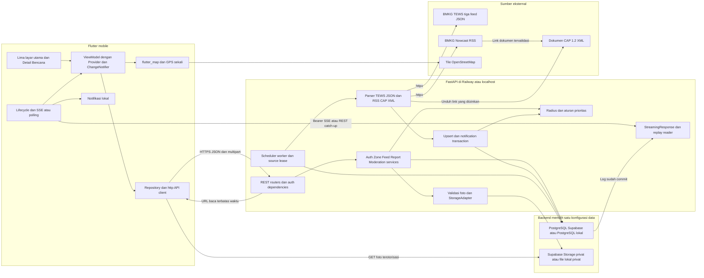
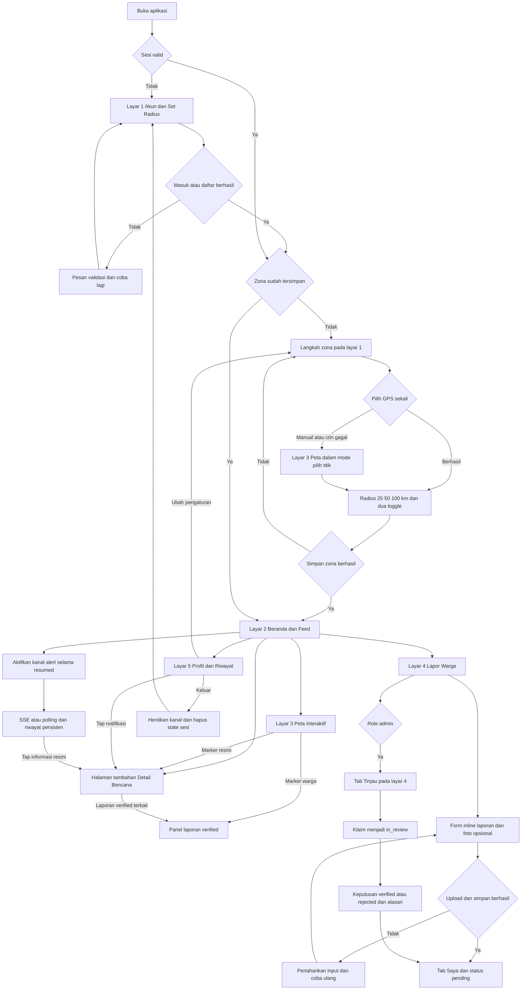
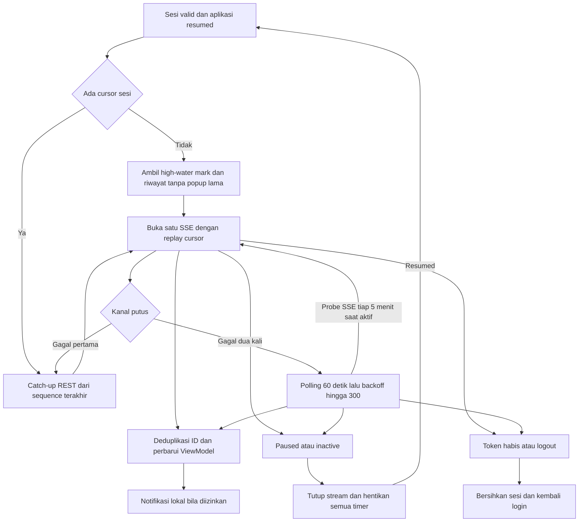
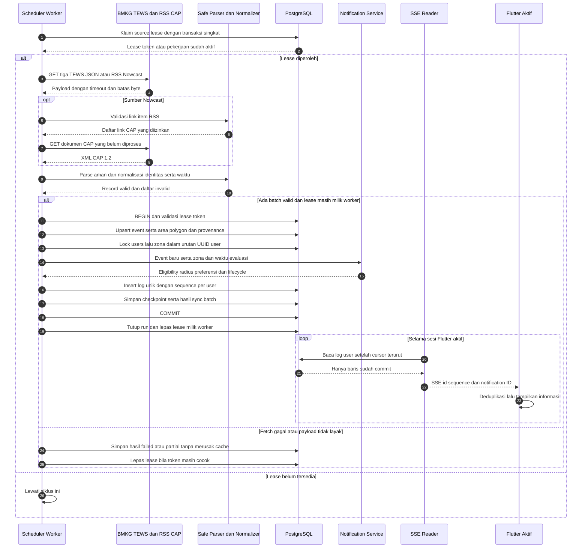
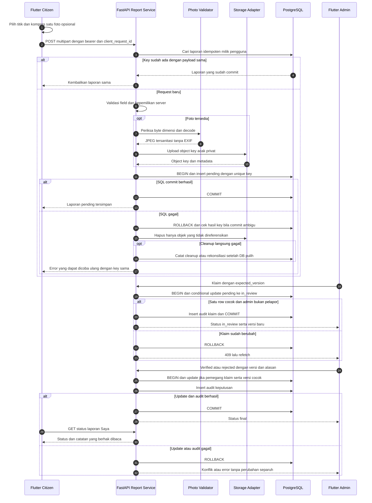
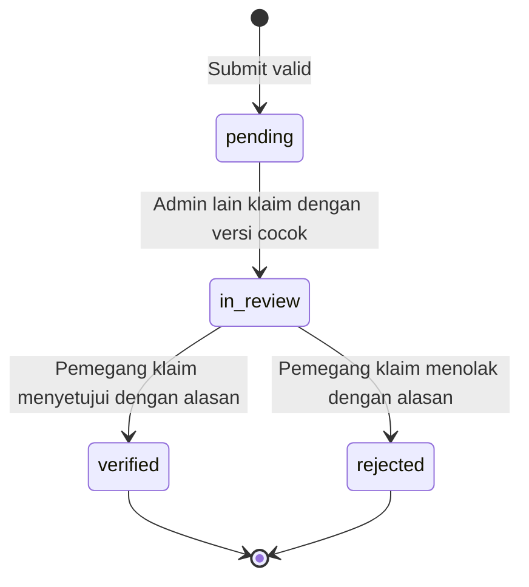
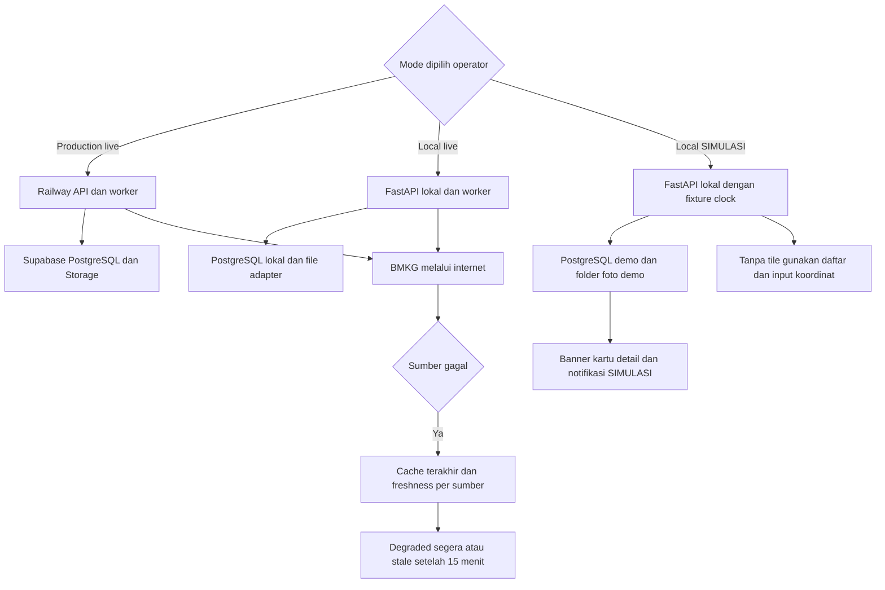

# Arsitektur — Siaga Bencana

**Author:** Jiddan Ibnu Ali — **NIM:** 24051214203  
**Tanggal:** Senin, 16 November 2026 — Hari 2  
**Status:** LOCKED 16 November 2026; [ERD.sql](ERD.sql), [API_CONTRACT.md](API_CONTRACT.md), dan [UI_SPEC.md](UI_SPEC.md) selesai untuk implementasi mulai 17 Nov.

Acuan normatif: [AGENTS.md](../AGENTS.md), [IDEA.md](IDEA.md), dan [PRD.md](PRD.md). Nilai numerik serta acceptance criteria mengikuti PRD; dokumen ini menjelaskan penempatan tanggung jawab dan batas transaksi. Semua diagram memakai blok Mermaid standar GitHub tanpa HTML, ikon eksternal, atau konfigurasi JavaScript. Label node flowchart selalu dikutip. Nama direktori di bawah adalah rancangan implementasi, belum dibuat pada sesi dokumentasi.

## 1. Keputusan arsitektur dan stack

Satu aplikasi Flutter tipis, satu backend FastAPI modular beserta worker terjadwal, satu database PostgreSQL relasional, dan adapter penyimpanan gambar. Seluruh autentikasi, query bisnis, sync, radius, prioritas, upload dan moderasi melewati FastAPI. PostgreSQL menjadi sumber kebenaran; SSE hanya mengantarkan notification_logs yang sudah commit.

| Lapisan | Stack terkunci dan kegunaan |
|---|---|
| Mobile | Flutter **3.47.7**, Dart **3.13.5**, Material 3; `Provider` / `ChangeNotifier` MVVM; `go_router`; JSON manual tanpa `build_runner`; `http`; `geolocator`; `flutter_map` + OpenStreetMap; `flutter_local_notifications`. |
| API dan worker | Python **3.15.0**, FastAPI **0.163.0**, Uvicorn **0.54.0**; SQLModel/SQLAlchemy, Pydantic v2, `pydantic-settings`, `psycopg[binary]`, `httpx`, `python-multipart`, `StreamingResponse`, `pytest`. |
| Gambar dan auth | `pillow`, `pwdlib[argon2]`, `pyjwt`; server decode/re-encode foto, hash password dan validasi JWT. |
| Database | PostgreSQL di Supabase saat production; PostgreSQL lokal dengan DDL identik saat fallback; tanpa NoSQL/SQLite pengganti. |
| Storage | Supabase Storage private bucket atau direktori privat lokal di belakang adapter API. |
| Deployment | Railway; konfigurasi lokal lewat env; Flutter base URL dapat diganti untuk emulator/HP LAN. |

Hasil verifikasi binary wheel untuk Python 3.15 (`--only-binary=:all:` exit 0) dan struktur feed diterima dari user pada 16 Nov; bukan pengujian ulang sesi ini. Tidak menambahkan `geopandas`, `shapely`, Firebase SDK, `dio`, Redis, broker, atau PostGIS. Pemrosesan polygon menggunakan Python/SQL ringan; frontend tidak mengulang keputusan bisnis server.

## 2. Diagram sistem end-to-end



Panah mobile ke Storage hanya **GET gambar memakai URL sementara yang diterbitkan backend**. Pada mode lokal URL itu ditangani route media FastAPI; pada Supabase berupa signed URL bucket privat. Mobile tidak mengunggah langsung ke Storage dan tidak pernah menerima koneksi database/service key. Panah ke tile OSM hanya untuk basemap, bukan sumber data bisnis. Feed tidak terhubung langsung ke BMKG.

Satu instance API dan satu loop worker cukup untuk demo. Worker bisa berada dalam lifecycle FastAPI pada deployment MVP dengan satu proses Uvicorn; pemisahan entry point worker nanti boleh tanpa menambah layanan logis. Jangan menjalankan scheduler otomatis di setiap replica/worker. Loop SSE tidak boleh memblokir event loop; DB sync memakai threadpool terbatas atau psycopg async dengan sesi terpisah per unit kerja. Pillow/decode gambar berjalan dalam pekerjaan terbatas, bukan loop SSE.

## 3. User flow utama



Kotak form, panel, tab, dan proses jaringan adalah state internal, bukan rute layar baru. Konfirmasi klaim/keputusan gagal karena konflik kembali ke Tab Tinjau dan refetch; hanya backend menentukan status. Mode pilih titik tanpa tile menyediakan input lat/lon pada panel Peta, sehingga setup lokal offline tetap mungkin. Izin lokasi ditolak tidak menghalangi penggunaan aplikasi.

### Lifecycle kanal alert



Sukses SSE membatalkan timer polling. Reconnect pertama diberi jeda singkat berjitter, bukan busy loop; dua kegagalan masuk fallback PRD. Heartbeat 20 detik, client timeout 45 detik, polling 60/120/240/300 dengan jitter ±10%. Notifikasi lokal bukan layanan push; app mati tidak menerima jaminan alert. Riwayat database dapat dibaca setelah masuk kembali.

## 4. Sequence sync TEWS, Nowcast dan notifikasi



Diagram menggabungkan dua keluarga sumber untuk ringkas; **TEWS dan Nowcast mempunyai lease, transaksi, bootstrap dan status sukses masing-masing**. Sumber yang gagal tidak rollback keberhasilan sumber lain. Payload diunduh/di-parse sebelum transaksi upsert; jangan menahan row lock database selama HTTP BMKG. Semua data valid dari satu batch, notification_logs dan checkpoint commit bersama; invalid dicatat sebagai partial. Kegagalan transaksi menyebabkan rollback batch; retry aman karena key/constraint. Loop SSE adalah pekerjaan reader independen; worker melepas lease setelah menyimpan hasil dan tidak menunggu koneksi Flutter berakhir.

### 4.1 Lock worker dan pemulihan

- Konfigurasi satu scheduler tetap dilindungi lease SQL agar restart atau proses ganda tidak menjalankan sumber yang sama bersamaan.
- Di transaksi singkat, ambil `pg_try_advisory_xact_lock` dengan key tetap per sumber lalu periksa/update baris `sync_runs` berstatus running. Klaim disimpan dengan `lease_token` unik dan `lease_until`; hanya satu running row per sumber lewat partial unique index. Lease **300 detik**, deadline pekerjaan **240 detik**.
- Lock transaksi hanya untuk klaim, bukan sesi yang diasumsikan melekat pada satu koneksi. Ini menghindari ketergantungan session advisory lock pada transaction pooler. Klaim usang ditandai abandoned sebelum klaim baru dalam transaksi yang sama.
- Sebelum commit batch, lock baris lease dan periksa token serta expiry; worker lama yang kehilangan lease tidak boleh menulis. Saat selesai, hanya pemilik token boleh menutup run. Bila database mati, worker tidak dapat memegang lease/menulis; hentikan proses batch dan laporkan readiness gagal tanpa membocorkan rahasia.
- Worker yang mati setelah commit tetapi sebelum mengakhiri run dapat dipulihkan setelah lease habis. Checkpoint/event unik membedakan data yang sudah commit; replay tidak membuat notification_logs kedua.

### 4.2 Normalisasi TEWS

Tiga endpoint membentuk satu namespace sumber `BMKG_TEWS`. Parse `Infogempa/gempa` yang dapat objek tunggal atau daftar menjadi list internal. Gunakan `DateTime` UTC dan `Coordinates` sebagai identitas; bentuk key SHA256 dari namespace TEWS, waktu kanonik, lat/lon enam desimal. File `autogempa/gempaterkini/gempadirasakan` tidak menjadi bagian key. Simpan `first_seen_at`, `last_seen_at`, waktu sumber, content version dan provenance endpoint.

`Magnitude`/`Kedalaman` berupa teks dinormalisasi menjadi angka bila valid; `Potensi`, `Dirasakan`, `Shakemap`, `Wilayah`, `Lintang` dan `Bujur` tetap tersedia sesuai sumber. Missing field tidak menghapus field valid; konflik satu siklus mengikuti auto → terkini → dirasakan. Jangan mengarang magnitudo nol, potensi tsunami, atau ID BMKG. Perubahan waktu/koordinat menghasilkan key baru; keterbatasan deduplikasi koreksi sumber dinyatakan di PRD.

### 4.3 RSS, CAP dan geometri Nowcast

Alur parser: baca RSS 2.0 → item guid/link → validasi URL dan byte → parse CAP namespace → pilih info Indonesia/fallback pertama → simpan header/info dan seluruh area/polygon → hitung bbox/centroid → evaluasi lifecycle. RSS pubDate dipakai provenance, sedangkan sent/effective/expires CAP menentukan semantik waktu. CAP `identifier` adalah key sumber unik; guid RSS memudahkan menghindari unduhan berulang, tetapi tidak boleh menghalangi pemrosesan perubahan dokumen yang diketahui.

Worker memakai content hash untuk mendeteksi perubahan; endpoint list hanya mengambil ringkasan. CAP references, jika tersedia, disimpan untuk hubungan Update/Cancel; pesan lifecycle yang tidak dapat dirujuk ditandai tidak lengkap dan tidak menerbitkan alert baru. Jangan mengasumsikan field references selalu ada pada hasil live yang diberikan user. Resolusi rujukan boleh ditunda sampai event rujukan tersedia, tetapi versi lama tidak otomatis aktif kembali karena RSS tidak lagi memuatnya. Keaktifan selalu dihitung dengan waktu sekarang dan status superseded/cancelled yang tersimpan.

Geometri tanpa GIS berat:

1. Tolak vertex non-finite/di luar batas, ring kurang dari tiga vertex unik, atau ring degenerate; tutup ring valid bila vertex akhir belum sama dengan awal. Validasi bentuk/self-intersection sederhana sesuai batas ukuran; geometri yang tidak dapat dipercaya ditandai invalid, tidak dipaksakan sebagai lokasi.
2. Unwrap longitudes per ring supaya selisih antartitik memakai lintasan terpendek; simpan bbox antimeridian sebagai dua interval atau flag crossing. Centroid dihitung pada ring yang telah di-unwrap lalu longitude dinormalisasi. Centroid polygon konkaf bisa di luar area; karena itu marker hanya representatif.
3. Ray casting dengan pemeriksaan point-on-segment menentukan inside termasuk boundary. Uji semua polygon area. Polar/degenerate shape yang algoritmanya tidak mendukung ditandai kecocokan belum tersedia, tidak diberi inside palsu.
4. Di luar polygon, minimum Haversine centroid/vertex dipakai sebagai **jarak sampel perkiraan**. Bbox hanya pruning konservatif; jarak sampel tidak diberi nama jarak minimum ke tepi. Contoh false negative pada tengah sisi panjang menjadi fixture wajib AC-09.
5. Simpan/paparkan `match_method`, `match_distance_km`, `area_description`, `priority_algo` dan `priority_reasons`. Nowcast tidak memiliki S/P/M/T; label berdasarkan severity dan waktu/status CAP sebagaimana PRD.

Payload XML dibatasi sebelum parse pada hasil dekompresi, bukan hanya Content-Length. Terapkan allowlist URL/redirect, larangan DTD/entity, encoding UTF-8, batas kedalaman/node/vertex dan tidak menjalankan XInclude sesuai PRD. Parser stdlib bukan alasan mengabaikan input berbahaya. Jika satu dokumen tidak layak, dokumen valid lain tetap dapat diproses sebagai partial.

### 4.4 Consistency notifikasi dan cursor

notification_logs berfungsi sebagai riwayat sekaligus sumber replay; tidak perlu message broker. Pada batch baru:

1. Upsert event mengembalikan apakah event benar-benar baru atau pengayaan. Bootstrap pertama sumber hanya memasukkan cache.
2. Ambil kandidat zona; lock users lebih dahulu, lalu alert_zones, dalam urutan UUID user yang konsisten untuk menghindari deadlock. Semua jalur update zona/counter mengikuti urutan lock yang sama; baca ulang versi zona setelah lock.
3. Terapkan jenis preferensi, cutoff `alert_eligible_since`, umur/active window dan kecocokan lokasi. Hitungan server tidak bergantung pada izin notifikasi OS.
4. Untuk kandidat yang belum memiliki log unik, increment `users.last_notification_sequence` dan insert log dalam transaksi yang sama. Sequence per pengguna menjadi monoton sesuai urutan commit karena counter row lock dipegang sampai commit. Unique `(user_id, sequence)` dan `(user_id, event_id, kind)` wajib.
5. Simpan snapshot alasan/zone_version/evaluated_at untuk menjelaskan alasan saat notifikasi diterbitkan. Detail event boleh menampilkan keadaan terkini setelah update; jangan mengubah riwayat alasan secara diam-diam.

SSE membaca log ascending dari cursor lewat query kecil setiap sekitar 2 detik saat ada koneksi, heartbeat 20 detik; tidak memegang transaksi/koneksi DB selama stream idle. Gunakan pool terbatas dan release sesi setiap query. Dengan target 20 client aktif desain ini cukup; fan-out in-memory boleh optimasi tetapi tidak boleh menjadi satu-satunya sumber replay. Proxy harus menonaktifkan buffering SSE dan punya idle timeout melebihi heartbeat; verifikasi deployment masih diperlukan.

Delivery at-least-once; Flutter memakai ID log untuk deduplikasi dan ID notifikasi lokal stabil. Startup/login membaca high-water mark **lebih dahulu**, lalu riwayat, lalu SSE `since_sequence` bersama `cursor_user_id` dari mark tersebut: commit yang terjadi setelah mark akan direplay; data riwayat yang overlap dideduplikasi. Resume dalam sesi menggunakan cursor terakhir tanpa membuang notifikasi yang terlewat. History `read_at` berbeda dari cursor diterima. Replay juga mengambil lifecycle event terkini: CAP expired/cancelled/superseded tetap di riwayat tetapi tidak menghasilkan popup peringatan aktif dari snapshot lama. Tidak ada pemangkasan log otomatis pada MVP.

## 5. Sequence upload dan moderasi transaksional



Validasi auth/role/self-review dilakukan sebelum aksi update; kondisi SQL mengulang syarat status/version/reviewer untuk mengatasi race. Diagram tidak memperlihatkan semua cabang `401/403/413/415/422`, yang dicakup API_CONTRACT.md. Untuk retry key yang sudah ada, backend tetap memvalidasi dan menghitung hash konten untuk mendeteksi penggunaan key dengan payload berbeda, bukan mempercayai hash dari client.

Kompresi client bukan kontrol keamanan. File JPEG <=2 MiB di-decode ulang, batas sisi input 4096 px/16 MP, lalu disimpan sebagai JPEG maksimum 1024 px tanpa metadata. Hash idempotensi memakai field kanonik serta digest hasil foto sanitasi yang deterministik; implementasi harus menetapkan pengaturan encoder dan versi algoritma agar retry pada versi aplikasi yang sama konsisten. Tidak ada foto → tidak ada panggilan Storage.

Supabase/file store dan PostgreSQL tidak dapat commit bersama. Objek terunggah yang tidak direferensikan dihapus secara kompensasi; cleanup yang gagal masuk antrean kecil SQL `media_cleanup_jobs`, bukan broker baru. Bila DB juga gagal, rekonsiliasi terjadwal membandingkan inventory objek dan referensi SQL **setelah DB sehat**, hanya menghapus objek tak terpakai dengan umur >24 jam dan bukan upload aktif. Tidak boleh menjalankan cleanup dengan daftar referensi kosong akibat query DB gagal. Object key kandidat berbeda per request in-flight; loser unique constraint tidak menghapus objek milik laporan pemenang. Timeout commit ambigu diselesaikan lewat lookup idempotency sebelum penghapusan.

### State laporan dan otorisasi



State final tidak dihapus; simbol akhir berarti tidak ada transisi MVP. Tidak ada pending → verified, reopen, edit final, self-review, atau reassignment otomatis. Setiap transisi moderator memiliki satu audit dalam transaksi yang sama; submit awal dibuktikan reporter/created_at. Version increment dan unique `(report_id, resulting_version)` membantu memastikan satu audit per transisi. Klaim macet tetap menjadi tugas admin pemilik, dengan keterbatasan yang dinyatakan di PRD.

## 6. Layer mobile yang direncanakan

```text
mobile/lib/
  app/                 bootstrap, theme Material 3, router guards, API base URL
  core/network/        http client, bearer header, timeout, error envelope, SSE parser
  core/lifecycle/      satu koordinator SSE atau polling dan notifikasi lokal
  models/              DTO serta fromJson/toJson manual
  repositories/        auth, zone, event, report, notification; akses REST saja
  viewmodels/          ChangeNotifier per fitur, paging dan state UI
  views/               lima layar utama dan satu Detail Bencana
  widgets/             source badge, freshness banner, priority reasons, empty/error
```

View hanya merender dan menerima input. ViewModel mengelola loading/empty/error/offline/degraded/SIMULASI, filter, deduplikasi paging dan pembatalan request usang. Repository memetakan DTO; API client tidak menyimpan log password/token. Routing menjaga login dan zona; tab Tinjau memakai role dari server, sementara endpoint tetap mengotorisasi sendiri.

Simpan access token dan cache privat hanya di memori sesi; restart/login baru membentuk baseline notifikasi. Flutter `http` membuka stream dengan header Authorization dan parser SSE yang menangani chunk terpotong, CRLF, beberapa baris data, komentar heartbeat, dan cursor id. Jangan menganggap satu network chunk sama dengan satu event. Close `http.Client`, cancel subscription/timer saat logout/dispose/paused; jangan membuat koneksi baru untuk setiap rebuild widget.

List default 20/maksimal 50; peta endpoint ringkas maksimal 100 total dengan truncated. Backend menyediakan distance, reasons, priority label, source, evaluated_at, zone_version; frontend tidak menghitung ulang rumus. Poligon lengkap hanya bila dibutuhkan detail, bukan list/marker; gambar thumbnail lazily loaded dan URL kedaluwarsa diminta ulang lewat API. Notifikasi lokal memakai kanal dan izin OS; izin ditolak tidak menghambat feed/riwayat.

## 7. Layer backend yang direncanakan

```text
backend/app/
  main.py              FastAPI lifecycle dan dependency wiring
  core/                settings, auth, logging, limits, clock
  api/                 routers dan Pydantic request/response DTO
  models/              SQLModel entities dan relasi PostgreSQL
  repositories/        query terparameterisasi dan transaksi
  services/            auth, zone, feed, radar, report, moderation, notification
  integrations/bmkg/   client httpx, TEWS parser, RSS dan CAP parser aman
  workers/             scheduler, source lease, sync, media reconciliation
  storage/             interface, Supabase adapter, local adapter
  tests/               unit, HTTP, PostgreSQL concurrency, fixture sumber
```

Services memegang aturan dan batas transaksi; router tidak berisi query bisnis tersebar. Pydantic menolak field yang tidak dikenal pada aksi sensitif (role/status/reporter). Input DTO terpisah dari ORM/public DTO agar email, hash, provenance privat dan audit tidak otomatis terserialisasi. Query radius menggunakan bbox konservatif lalu Haversine; rumus skor versi `eq-priority-v1`, CAP `cap-priority-v1`, clock dapat diinjeksi untuk test. List campuran tidak menyetarakan skor gempa dan severity.

Auth memakai password hash Argon2, JWT 60 menit dengan algoritma allowlist, issuer/audience/expiry, user aktif serta role server. Tidak ada Supabase Auth client bypass. Upload masuk FastAPI; URL foto diberikan sesudah pengecekan report visibility. Rate limit, request limit, timeout, CORS bila digunakan, dan trust proxy diatur di satu tempat. API production TLS; HTTP lokal hanya development.

Error envelope final memuat code, message, details (object/null, termasuk fields bila ada), request_id; tidak memuat traceback/DSN. Kode semantik: `401` sesi invalid, `403` role/self-review, `404` resource tidak ada/tidak boleh diketahui, `409` konflik versi/idempoten, `413` ukuran, `415` tipe, `422` validasi, `429` throttle dan `503` dependency tidak tersedia. GET feed dari cache saat BMKG gagal tetap `200` dengan freshness/degraded metadata, bukan `503` selama API+DB sehat.

## 8. Relasi data dan constraint final

DDL final di [ERD.sql](ERD.sql) memakai schema `siaga` (tidak diekspos PostgREST), UUID seluruh PK, timestamptz dan CHECK/UNIQUE/FK RESTRICT. Tabel berikut memetakan tanggung jawab; nama kolom persis mengikuti DDL. Trigger menjaga transisi dan audit atomik, service menjaga otorisasi requester, eligibility, geometri dan fence worker.

| Tabel | Relasi dan invariant yang wajib diwujudkan |
|---|---|
| users | PK; email normalized unique; role citizen/admin CHECK; password_hash; active; counter last_notification_sequence. Tidak ada hard delete akun MVP. |
| alert_zones | FK users UNIQUE; latitude/longitude valid, radius_km preset; notify_earthquake/notify_weather, zone_version, alert_eligible_since. Satu zona per akun. |
| disaster_events | PK; source/source_key UNIQUE; jenis gempa/cuaca; waktu UTC, optional atribut TEWS/CAP bertipe, source URL/provenance, content version, first/last_seen, is_simulated. Missing != nol. Koordinat nullable untuk CAP geometri invalid. |
| event_areas | FK event; urutan area, areaDesc; satu event dapat banyak area CAP. |
| area_polygons | FK area; urutan polygon; centroid/bbox/crosses_antimeridian/geometry_valid. |
| polygon_vertices | FK polygon; sequence; lat/lon CHECK; UNIQUE polygon dan urutan. Geometri tetap relasional, bukan database dokumen. |
| event_references | FK event pengirim; source key rujukan, jenis Update/Cancel; FK referenced_event nullable sampai rujukan ditemukan. Simpan rujukan tanpa mengarang event. |
| citizen_reports | FK users, event nullable; kategori lima nilai, deskripsi, lokasi, status, reviewer FK users nullable, version, object key/metadata opsional, client_request_id dan payload_hash. UNIQUE reporter/request key; reviewer bukan reporter dan konsistensi status/reviewer. |
| report_verifications | FK report dan moderator; status asal/tujuan, reason, waktu, resulting_version; UNIQUE report/version. Append-only. |
| notification_logs | FK user/event; kind official_new, sequence, created/read_at, zone_version dan snapshot alasan/evaluasi; UNIQUE user/event/kind dan user/sequence. |
| sync_runs | Sumber, hasil, counters, success/checkpoint, lease_token/lease_until; satu run aktif per sumber lewat partial unique index; diagnostics tersanitasi. |
| media_cleanup_jobs | Object key unik, status/retry/next_attempt_at/error singkat untuk compensating delete. Operasional storage, bukan antrean bisnis umum. |

Atribut CAP seperti severity/urgency/certainty/effective/expires dapat berupa kolom nullable bertipe pada disaster_events untuk MVP; DDL memberi CHECK sesuai jenis. JSONB opsional hanya snapshot provenance/komponen alasan, bukan pengganti relasi inti, PK/FK atau tabel geometri. Kolom sumber mentah tidak diekspos langsung di API publik.

Index minimum: event `(occurred_at, id)` dan source key; kandidat lat/lon/bbox dengan query antimeridian teruji; report `(status, created_at, id)`, `(reporter_id, created_at, id)`, event_id; audit `(report_id, created_at, id)`; log `(user_id, sequence)` dan `(user_id, created_at, id)`; FK area/polygon/vertices; lease/cleanup yang sedang aktif. Index lat/lon biasa bukan jaminan query spasial cepat, gunakan EXPLAIN pada dataset target.

FK inti RESTRICT untuk menjaga audit/riwayat; tidak ada endpoint delete MVP. Reset SIMULASI adalah operasi operator pada database demo terpisah, bukan DELETE produksi lewat aplikasi. DDL membedakan aturan CHECK dan aturan transaksi/locking, terutama role/self-review/validasi aktor dan transisi status; jangan menulis CHECK yang mencoba membaca tabel lain.

## 9. Storage adapter dan batas keamanan

Interface minimum: `put_sanitized_image`, `create_read_url`, `delete_if_unreferenced`, dan inventory terbatas untuk rekonsiliasi. Parameter berupa object key server, byte JPEG tersanitasi, mime, checksum; bukan path dari user. Metadata SQL menyimpan object key, ukuran, dimensi dan provider, **bukan signed URL permanen**. URL 5 menit dibentuk saat request yang berhak.

| Aspek | Supabase | Lokal |
|---|---|---|
| Simpan | Private bucket; kredensial server env | Folder di luar area statis publik, nama acak |
| Baca | Signed URL yang dibuat backend setelah otorisasi | URL route FastAPI dengan signature/expiry, token terikat objek; validasi sebelum streaming |
| Hapus kompensasi | API object delete melalui adapter | Delete hanya key tervalidasi di storage root |
| Isolasi SIMULASI | Bucket/proyek terpisah bila dipakai | Database dan folder demo terpisah |

Path traversal diblokir dengan pemetaan key ke path yang di-resolve di bawah storage root; jangan menerima nama filesystem mentah. Expired URL gagal; refresh harus kembali melewati auth/visibility. Seed menggunakan foto sintetis/tanpa data pribadi, bertanda SIMULASI. File final tidak menyimpan EXIF GPS, filename asli atau kredensial.

Trust boundary: mobile dan input sumber eksternal tidak dipercaya; server mengotorisasi; database menegakkan integritas; Storage hanya berisi hasil sanitasi. SQL parameterized, JWT tidak dikirim lewat query string SSE, rahasia tidak masuk log/APK, zone coordinates dan email tidak ikut respons publik. XML/URL controls dan rate limit mengikuti PRD bagian 8. Swagger digunakan untuk QA API yang tetap terautentikasi; bukan pengganti tab moderasi maupun akses admin tanpa auth.

## 10. Deployment, degradasi dan fallback demo



Tidak ada panah otomatis dari production ke SIMULASI. Jika Railway gagal, operator menjalankan lokal dan mengganti base URL; aplikasi tidak mengalihkan akun/POST diam-diam ke database lain. Jika BMKG gagal tetapi API hidup, baca cache last-success dengan status per sumber. Jika database gagal, API readiness gagal dan operasi bisnis mengembalikan error; client hanya menampilkan cache memori bertimestamp. Jika tile atau foto gagal, teks/daftar tetap berfungsi.

### Konfigurasi rancangan

| Konfigurasi | Nilai/peran |
|---|---|
| APP_MODE | production_live, local_live, simulation; validasi kombinasi saat startup |
| DATABASE_URL | DSN PostgreSQL Supabase atau lokal, secret server |
| STORAGE_BACKEND | supabase atau local |
| STORAGE_ROOT / STORAGE_BUCKET | Lokasi privat sesuai mode; simulation memakai namespace terpisah |
| SUPABASE_URL / SUPABASE_SERVICE_KEY | Hanya server pada adapter Supabase |
| JWT_SECRET / JWT_ISSUER / JWT_AUDIENCE | Kunci dan validasi token; tidak disimpan di repo |
| BMKG_SYNC_ENABLED / SYNC_INTERVAL_SECONDS | Live true/300; simulation live sync false |
| SIMULATION_CLOCK | Jam fixture eksplisit untuk expiry/replay demo, tidak menimpa waktu asli sumber |
| API_BASE_URL | Konfigurasi Flutter menuju Railway, host emulator atau IP LAN |

Nama env di atas terkunci sesuai metadata mode API_CONTRACT.md; implementasi membuat `.env.example` tanpa rahasia pada fase build. Jangan membuat/menjalankan `.env` dalam sesi dokumentasi ini. Railway memakai koneksi PostgreSQL TLS dan pooler Supabase bila konektivitas IPv4 membutuhkannya; size pool konservatif, satu worker, lease SQL yang tidak bergantung session affinity. Uji proxy SSE, lifecycle reconnect, pooler dan restart di Railway masih merupakan pekerjaan implementasi.

### Runbook yang harus diwujudkan Antigravity

1. Siapkan dependency dan PostgreSQL lokal sebelum demo; terapkan DDL identik lewat mekanisme migration/init terdokumentasi, bukan schema berbeda untuk lokal.
2. Pilih database/folder **demo** dan APP_MODE simulation. Jalankan seed idempoten berlabel SIMULASI dengan citizen + dua admin, event dalam/luar/batas radius, CAP beberapa polygon/expired, laporan semua status dan notifikasi. Seed hanya boleh berjalan pada mode/database demo.
3. Nonaktifkan worker BMKG live. Fixture runner memakai pipeline normalisasi/notification yang sama untuk membuktikan dedup/replay; fase bootstrap pertama tidak menerbitkan alert, fixture berikutnya menciptakan event baru setelah cutoff zona.
4. Jalankan API lokal, pastikan health/readiness, schema dan storage write/read lulus; alamat emulator `http://10.0.2.2:<port>` atau HP `http://<IP-LAN-host>:<port>`. Host bind/firewall LAN disiapkan khusus demo. Jangan memakai localhost HP untuk menunjuk komputer.
5. Putus internet; demonstrasikan login, set zona manual, feed/detail, laporan/foto lokal, dua admin konflik, keputusan/audit, SSE putus/polling/resume. Tile offline memakai placeholder/daftar dan panel input koordinat; tidak menjanjikan peta offline penuh.
6. Reset hanya dataset demo terpisah setelah menunjukkan identitas mode/database. Jangan mengubah data production dan jangan menggunakan akun/kredensial nyata pada video.

Target start lokal <=10 menit setelah dependency tersedia. Dokumentasi Hari 2 belum merupakan bukti bahwa deployment/fallback sudah berjalan.

## 11. Pemetaan validasi dan tugas lanjutan

| Area arsitektur | Bukti yang harus dibuat pada implementasi |
|---|---|
| Sumber/identity/cache | PRD AC-07/10/11/21; fixture kedua sumber, invalid XML, worker mati sebelum/sesudah commit, lease usang. |
| Radar/geometri | AC-04/05/06/08/09; jam beku, ±180, kutub, tepi polygon, null dan batas skor. |
| Upload/akses | AC-14/15/16/24; media palsu, EXIF, orphan, commit ambigu dan IDOR. |
| Moderasi SQL | AC-01/17/18; dua koneksi PostgreSQL konkuren, rollback ketika audit gagal. |
| Stream/lifecycle | AC-12/19/20/23; cursor terurut commit, duplicate delivery, token habis, paused tanpa timer. |
| Client/fallback | UI-01..06, AC-02/03/13/22, NFR-01..10; profile perangkat, payload dan demo tanpa cloud. |

Lock Planning 16 Nov menghasilkan [ERD.sql](ERD.sql), [API_CONTRACT.md](API_CONTRACT.md), dan [UI_SPEC.md](UI_SPEC.md); implementasi Slice 1 mulai 17 Nov mengikuti [HANDOFF.md](HANDOFF.md). Kontrak mengunci DTO sumber publik/privat, pagination, match_method, freshness, lifecycle CAP, error, idempotency key, expected_version, cursor per-user, signed URL dan mode SIMULASI. Tidak membuat endpoint bisnis langsung ke Supabase, rute layar ketujuh, atau fitur baru di luar PRD.

### Detail implementasi yang dikunci pada 16 Nov

- `users` lalu `alert_zones` dilock dalam urutan UUID user pada seluruh writer; counter+log tetap satu transaksi sampai commit. `zone_version` adalah nama kolom zona, `content_version` versi event, `version` versi laporan. SSE id `user_uuid:sequence`; REST `since_sequence` + `cursor_user_id`; tidak ada cursor lintas akun.
- `priority_score` mentah dihitung per zona pada response event, `priority_display` adalah format response saja; skor personal tidak disimpan pada event global. Snapshot log menyimpan priority_algo/priority_score/priority_label/priority_reasons/priority_components, evaluated_at dan zone_version. Flag semua DTO/data demo `is_simulated`.
- Status CAP dan msg_type menyimpan enum sumber; lifecycle_status derived dari waktu/references/cancelled_at/superseded_at. Semua area/vertices relasional, invalid geometry tidak membuat marker. Parent-source/references/topologi diperiksa service; tidak ada CHECK subquery lintas tabel.
- Trigger report membatasi pending1 → in_review2 → verified/rejected3, aktor admin/non-self, audit append-only; deferred constraint menolak commit transisi tanpa audit. Requester/expected_version tetap dicek service.
- SQL runtime role non-owner tidak punya DELETE/TRUNCATE/audit UPDATE. Ingestion role terpisah boleh menghapus anak geometri/reference yang diganti secara eksplisit dalam transaksi, tanpa menghapus event inti. Schema tidak diberikan ke anon/authenticated Supabase. Migration owner terpisah.
- photo-url Bearer → signed URL300detik; route lokal `/api/v1/media/reports/{report_id}/photo` hanya capability signature, bukan JWT query. `payload_hash` dibuat server `report-payload-v1` dengan sanitizer dipin; client retry mempertahankan key+byte asli.
- Lease/checkpoint/bootstrap/last_success dibawa dari run committed terbaru; bootstrap source selesai hanya setelah traversal awal lengkap. Partial menyimpan checkpoint tanpa mengaku last_success baru. Jam fixture tidak mengubah expiry JWT/URL atau lease.
